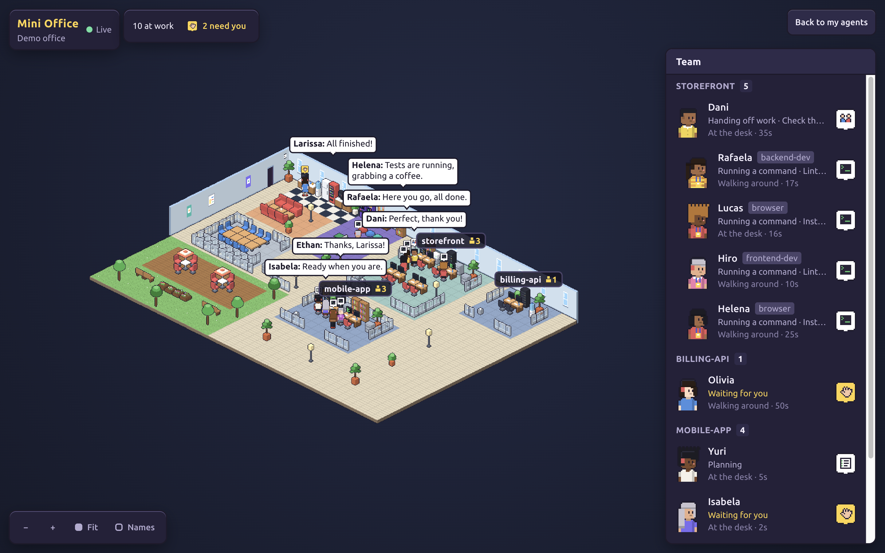
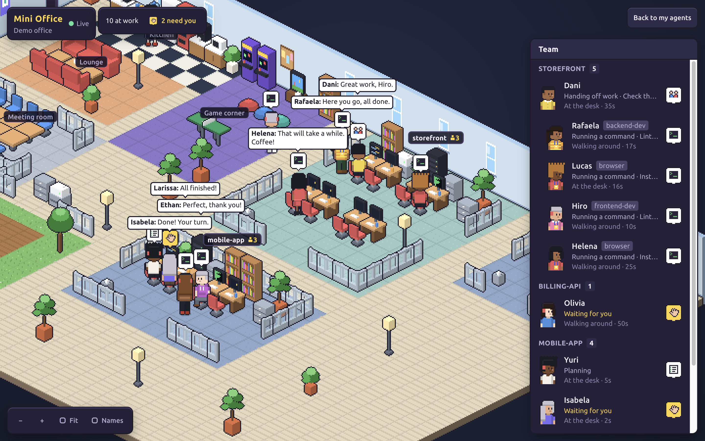
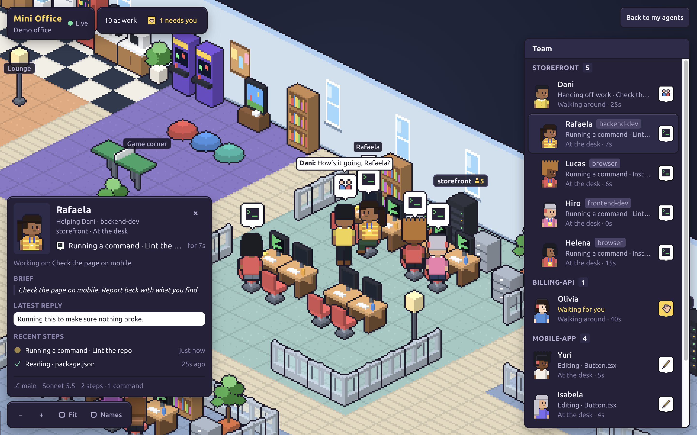
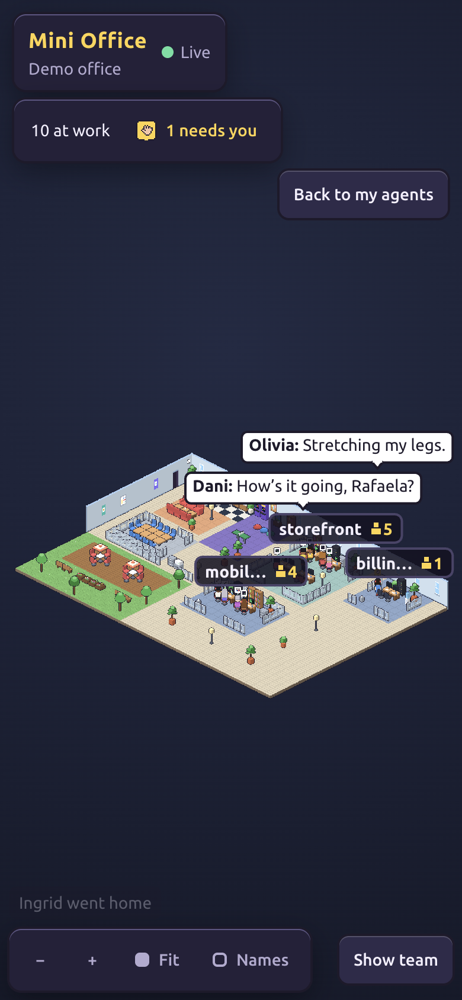

# Mini Office

**A retro isometric pixel office where every AI agent is a person and every project has its own area.**

Mini Office watches the Claude Code sessions running on your machine and turns them into one
living office. Agents walk in through the door, sit at their team's desks, grab coffee during
long commands, brief their helpers in the meeting room, and nap on the sofa when you leave them
idle too long.



```sh
pnpm install && pnpm dev   # then open http://127.0.0.1:5199
```

No agents running? Click **Try the demo** (or open `/?source=demo`) for a scripted office.

## What you'll see

- **One floor, many spaces.** By the entrance there's a kitchen, a lounge, a game corner
  (arcades, a TV with bean bags, ping-pong), a glass meeting room and an open-air terrace.
  Beyond the main corridor, every project folder gets its own team area behind low glass
  partitions. Worktrees and hidden work folders (`.claude/worktrees/x`, `.work/sites/x`) join
  their project's area.
- **Every agent is a person** with a stable random name and look. Subagents wear a lanyard
  badge and are listed under the person who called them.
- **Monitors show the work**: code for edits, a terminal for commands, pages for reading, a
  browser for web lookups. A bubble over each head says the same thing with an icon.
- **Real-life routines.**
  - New agents walk in through the main door and say hi. Agents that finish go home.
  - An agent that finishes waits at the desk with a raised hand, then goes off to play games,
    sit on the terrace or relax in the lounge. Leave it long enough and it naps.
  - A long command is a good excuse for a coffee.
  - New helpers are briefed in the meeting room by whoever called them, and they report back
    before leaving.
  - People chat wherever they hang out.
- **The office grows without breaking its layout.** When a team runs out of desks, its people
  step out to the shared spaces, the area is rebuilt bigger, and anything that had to shift
  rebuilds with it. Then everyone walks back.



## Everyone has a story

Click anyone to open their card:

- the latest request they were given, and the last thing they said;
- their recent steps, each marked running, done or failed;
- the files they touched, their helpers, the git branch and the model.



## Works on your phone

<p align="center">
  
</p>

## Run it

Requires Node 22.18+ and pnpm.

```sh
pnpm install
pnpm dev          # http://127.0.0.1:5199
```

To run it without Vite:

```sh
pnpm build
pnpm start        # http://127.0.0.1:4321 (PORT=… to change)
```

The UI is in English and Brazilian Portuguese.

## Privacy

Everything stays on your machine.

- The server only listens on `127.0.0.1`, and the API only answers requests addressed to
  `127.0.0.1`, `localhost` or `[::1]`.
- It reads Claude Code's files read-only and never writes to them.
- The office shows short hints: a file name, the command's description (or just the program
  name, never the full command line), a host name, a search query.
- Anything that looks like a key or token is masked.

## How it knows what agents do

The server reads Claude Code's own files:

| Source                                                                         | Used for                                                                                                                          |
| ------------------------------------------------------------------------------ | --------------------------------------------------------------------------------------------------------------------------------- |
| `~/.claude/sessions/<pid>.json`                                                | Live sessions: id, folder, busy/idle. Dead pids are skipped. The sibling `.key` files are never read.                             |
| `~/.claude/projects/<folder>/<session>.jsonl`                                  | The tail of each transcript: the tool in flight, thinking, end of turn, title. Only appended bytes are read after the first look. |
| `~/.claude/projects/<folder>/<session>/subagents/agent-*.jsonl` + `.meta.json` | Helpers: their type, task, activity, and when they hand back.                                                                     |
| Recently written transcripts with no registry entry                            | Headless runs (`claude -p`, SDK).                                                                                                 |

Snapshots stream to the browser over SSE (`/api/events?source=live|demo`). All the pixel art is
drawn in code; there are no image assets.

## Project layout

```
src/shared/          protocol (zod) and seeded randomness, used by both sides
src/server/          Node server: Claude Code source, demo source, SSE API
src/web/game/gfx/    procedural pixel art: avatars, furniture, the floor, icons, monitor screens
src/web/game/layout/ the floor plan (shared spaces, team areas), A* pathfinding
src/web/game/sim/    the office simulation: people, goals, renovations, meetings, chatter
src/web/game/render/ canvas renderer, camera, sprite cache
src/web/app/         React HUD: team panel, person card, controls
src/web/i18n/        English and Brazilian Portuguese
```

## Contributing

Issues and pull requests are welcome. Before opening a PR, run:

```sh
pnpm check   # typecheck, lint, prettier, tests, build
```

## License

[MIT](LICENSE)
